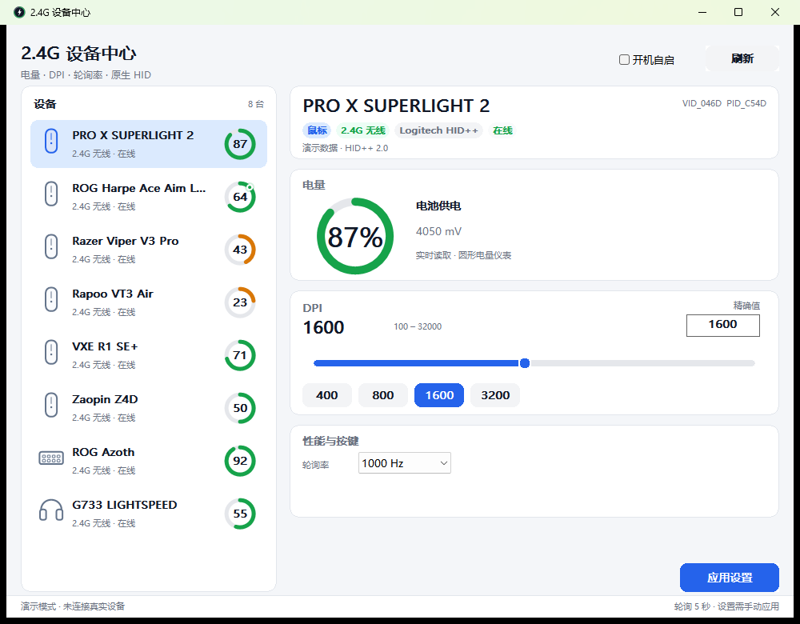

# 2.4G Device Center

[中文](README.md) | English

A tiny native Windows utility for 2.4 GHz wireless peripherals. It talks to vendor HID interfaces
directly and shows battery, charging state, DPI, polling rate and key settings. A single ~0.8 MB
x64 (PE32+) executable built with C++20, the Win32 API and GDI+.



## Features

- Native Win32 UI with large circular battery gauges; device list and tray icon also show battery.
- Animated ring fill, charging pulse and smooth DPI slider movement.
- Tray icon is a high-DPI circular badge with a large percentage and a colored level arc.
- System notifications for low battery (20%), critical battery (10%) and charging complete
  (100%, or unplugged at ≥99%), deduplicated per device.
- GDI+ vector device icons for mouse/keyboard/headset/generic, anti-aliased at any DPI.
- DPI slider uses a logarithmic scale; presets/stages are clickable.
- Background polling keeps the UI responsive; sleeping devices show the last reading or `--`.
- Tray menu: open, refresh, start with Windows, open log, exit.
- Demo mode: `--demo`; diagnostics: `--once` and `--diag`.
- No macros, lighting or firmware operations. No macro editor.

## Supported protocols

| Protocol / brand | Battery | DPI | Polling | Other settings |
| --- | --- | --- | --- | --- |
| Logitech HID++ 2.0 | ✅ | ✅ R/W | ✅ R/W | receiver pairing, names, onboard stages |
| ASUS ROG private HID | ✅ | ✅ 4 stages R/W | ✅ R/W | debounce, angle snapping, save |
| Razer HID | ✅ | ✅ R/W | ✅ R/W | up to 8000 Hz where supported |
| Rapoo 2.4G | ✅ | ✅ 7 stages R/W | ✅ R/W | debounce, angle snapping |
| Compx family | ✅ | partial: Zaopin enabled stages R/W | ❌ | Zaopin / LAMZU / VXE / Redragon / G-Wolves / Endgame |
| Nordic 54 | ✅ | ❌ | ❌ | ATK/VXE receivers |
| Aurora / mouse.xyz | ✅ | ❌ | ❌ | LAMZU / G-Wolves web-driver devices |
| Cherry HID | ✅ | ❌ | ❌ | wireless keyboards |
| Lofree WebHID | ✅ | ❌ | ❌ | Hyzen keyboards |
| Windows HID battery | ✅ | ❌ | ❌ | generic fallback |

### Zaopin Z4D (tested locally)

- `VID_3554`; `PID_F527` over the 2.4G receiver, `PID_F526` over the USB cable.
  Compx `0xFF02` 17-byte config pipe.
- Verified: 50 %, 3883 mV over 2.4G; 75 %, 3992 mV while charging over USB;
  current stage 0 → 3100 DPI, 4000 Hz polling, 8 ms debounce.
- One mouse is merged into one entry when it moves between the receiver and the USB cable. The
  live/charging transport supplies the battery, charging state and connection label; the previous
  transport is not retained as a second device with an old percentage.
- When both links are online, the 2.4G link is preferred because that is what the official driver
  reads. The percentage is the raw byte reported by the device, not rounded to 5% steps; a one-point
  difference from the vendor UI can therefore come from the two links or sampling boundaries.
- Flash layout: DPI records at `0x0C + 4*i` (`x, y, DPIex, checksum`), current stage at `0x04`,
  `maxDPI` at `0x02`, polling bitmask at `0x00`, debounce at `0xA9`.
- DPI decode: `code = x | (((DPIex >> 6) & 3) << 8)`, `unit = (DPIex & 0x22) ? 100 : 50`,
  `DPI = (code + 1) * unit`, `* 2` if `DPIex & 0x11`.
- **DPI write for Zaopin**: enabled stages and the current stage can be written. The app first
  writes the old record back as a self-test, then writes the new record and verifies it by reading
  it back; on failure it attempts to restore the old value. A confirmation dialog is shown before
  writing. Polling/debounce and macros/lighting remain read-only; use `Mouse Drive Beta` to add
  stages or change other settings.

## Quick start

Download `2.4G-Device-Center-v1.0.5-win64.zip` from
[Releases](https://github.com/SeyanaA/2.4g-device-center/releases/latest), extract and run
`WirelessCenter.exe` (64-bit Windows only).

```text
WirelessCenter.exe            start UI
WirelessCenter.exe --demo     demo devices, no hardware
WirelessCenter.exe --tray     start minimized to tray
WirelessCenter.exe --once     enumerate and print devices, then exit
WirelessCenter.exe --diag     dump HID interfaces for debugging
```

`--once` and `--diag` also write `%APPDATA%\2.4GCenter\last-console.txt`. Logs are in
`%APPDATA%\2.4GCenter\log.txt`.

Notes:

- A sleeping wireless mouse often does not answer until you move it. The app polls every 5 s.
- Close vendor software (Logitech G HUB, Razer Synapse, Zaopin Mouse Drive, etc.) if it holds the
  HID interface exclusively.
- Automatic polling only sends read/status requests. Writes happen only after you press
  **Apply settings** and confirm the Zaopin flash warning.
- Zaopin flash writes are limited to enabled DPI stages/current stage and are read-back verified.

## Architecture: Win32 API vs. Win64

"Win32" is the name of the Windows API family, not a 32-bit target. This project has always been
compiled as **x86-64 / PE32+**:

- Compiler target `x86_64-w64-mingw32`, PE machine `0x8664`, 8-byte pointers and handles.
- `src/common.h` fails with `#error` unless `_WIN64` is defined and `sizeof(void*) == 8`.
- `build.ps1` reads the PE header after linking and rejects anything whose machine is not `0x8664`.
- `--diag` prints `Architecture: x86-64 / PE32+ (64-bit process)` as its first line.
- Built with `-m64 -O2` and section GC; statically linked with no MinGW/VC++ runtime DLLs.

32-bit Windows is not supported, and there is no separate "Win64 API" to migrate to: the Win32 API
is the native API for 64-bit Windows. See [docs/PROJECT-CONTEXT.md](docs/PROJECT-CONTEXT.md) for the
full architecture and handoff notes.

## Battery notifications

- Uses Windows system notifications through the tray icon (`Shell_NotifyIcon`); on Windows
  10/11 they appear in the notification center, not as an in-app popup.
- Not charging at ≤20%: “Battery low” once; at ≤10%: “Battery critically low” once more.
- Reaching 100% while charging, or charging changing from 1 to 0 at ≥99%: “Charging complete”.
- State is tracked per physical device. Starting a charge, rising above 25%, or discharging below
  90% re-arms the corresponding notification, so it does not repeat every poll.
- On first launch, a device that is already low notifies immediately; an already full/charging
  device does not retroactively send “charging complete”.
- If Windows notifications are disabled, the footer shows `系统通知已关闭`; the tray menu has
  a “通知设置” entry that opens the Windows notification settings page and a “发送测试通知”
  entry that sends a test notification through the same path.
- Full behavior: [docs/SPEC-notifications.md](docs/SPEC-notifications.md).

## Build

### Self-contained buildkit (recommended)

Download `2.4G-Device-Center-v1.0.5-buildkit-win64.zip` from
[Releases](https://github.com/SeyanaA/2.4g-device-center/releases/latest), extract it, then run
`build.cmd` or `.\build.ps1`.

The package includes the official **w64devkit v2.10.1 x64** (`g++`, `windres`, headers, libraries)
as an unmodified self-extracting archive. The first build extracts it to `tools\w64devkit`; no
system MinGW installation is required.

w64devkit archive SHA-256:
`ADD1EDF984CE4D473CFEB7C52E0AB38DB73A855BBA6C7F564D5E16648EB2896A`.

### Use an existing toolchain

Requires MinGW-w64 (GCC 13+) or w64devkit with `g++` and `windres`:

```powershell
$env:W64DEVKIT = "C:\path\to\w64devkit"
.\build.ps1
```

or explicit:

```powershell
.\build.ps1 -Compiler "C:\msys64\mingw64\bin\g++.exe"
```

Makefile (toolchain must be in `PATH`):

```powershell
mingw32-make -f Makefile
```

The output is `WirelessCenter.exe` (x64 / PE32+, statically linked, no MinGW/VC++ runtime DLLs).
The build fails if the PE machine is not `0x8664`.
Only system DLLs are imported: kernel32, user32, gdi32, gdiplus, shell32, advapi32, hid,
setupapi, comctl32, ole32.

## Protocol notes

See [PROTOCOLS.md](PROTOCOLS.md) for report layouts, checksums, feature IDs and references to
Solaar, libratbag, OpenRazer, Rapoo Linux, VXE/LAMZU/G-Wolves reverse-engineering projects.

## Safety

- Automatic queries: status, battery, version, flash reads (read-only).
- Writes: only on explicit **Apply settings** for Logitech/ASUS/Razer/Rapoo.
- No lighting, macros, firmware or bootloader commands.
- Zaopin/Compx/Nordic/Aurora/Cherry/Lofree are display-only.
- No admin rights required; the only optional registry write is the per-user autostart entry.

## License

MIT. Brand names and trademarks belong to their respective owners. This project is not affiliated
with any vendor.
